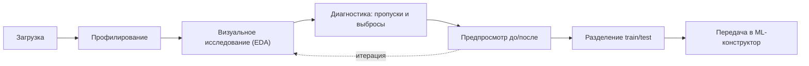

# Бизнес-контекст

## Основание и исходные требования

Основанием служат результаты анализа существующих платформ (см. [Сравнение платформ](platforms.md)). Модуль должен:

- автоматически профилировать загружаемые данные;
- предлагать несколько альтернативных стратегий очистки и трансформации;
- оценивать влияние выбранной стратегии на качество модели;
- давать интерактивную визуализацию на каждом этапе EDA;
- поддерживать итеративную корректировку без программирования (low-code/no-code).

## Целевой бизнес-сценарий

AutoML внедряется в организациях, где решения на основе данных нужны не только data scientist-ам, но и аналитикам, бизнес-экспертам и продуктовым специалистам. Типовой процесс: загрузка данных → исследование → подготовка → обучение модели → интерпретация. Модуль покрывает **первые, самые трудоёмкие и наименее автоматизированные этапы** и передаёт подготовленные данные основному ML-конструктору.

## Бизнес-проблемы

| № | Проблема |
|---|---|
| 1 | Предобработка недоступна нетехническим пользователям: платформы либо скрывают логику, либо требуют программирования |
| 2 | Неадаптивность: шаблонные стратегии без учёта профиля данных снижают качество моделей |
| 3 | Отсутствие прозрачности и доверия: пользователь не видит, как преобразуются данные и как это влияет на результат |
| 4 | Разрыв между предобработкой и моделированием: эффект шагов очистки не измеряется |
| 5 | EDA долгий и итеративный, рутина отнимает время у интерпретации |

## Бизнес-цели

- повысить качество итоговых моделей за счёт адаптивной предобработки;
- снизить порог входа и расширить круг пользователей AutoML (low-code/no-code);
- повысить прозрачность и доверие через визуальную и количественную обратную связь;
- сократить время подготовки данных, сохранив контроль пользователя;
- обеспечить воспроизводимость за счёт логирования всех шагов.

## Границы решения

=== "В границах"

    - загрузка и предпросмотр данных;
    - автоматическое профилирование и описательные статистики;
    - визуализация распределений и корреляций;
    - обнаружение пропусков и выбросов, предпросмотр обработки «до/после»;
    - разделение на обучающую и тестовую выборки.

=== "За границами"

    - автоматический подбор и обучение моделей и гиперпараметров (зона основного ML-конструктора);
    - развёртывание и мониторинг моделей;
    - полномасштабная работа с временными рядами и неструктурированными данными;
    - аутентификация, разграничение доступа, многопользовательский режим.

## Роль системы

Прозрачный, интерактивный и адаптивный **«помощник-исследователь» данных**: автоматизирует рутину, предлагает обоснованные рекомендации, оставляет решение за человеком.

## Концепция решения

Объединяет три принципа из [теоретических основ](theory.md): адаптивность, модельную осознанность и интерактивность с участием человека.

