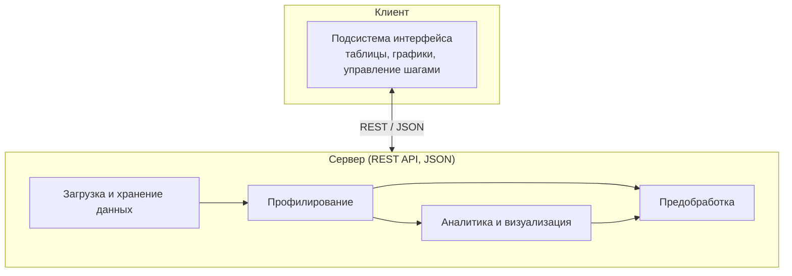
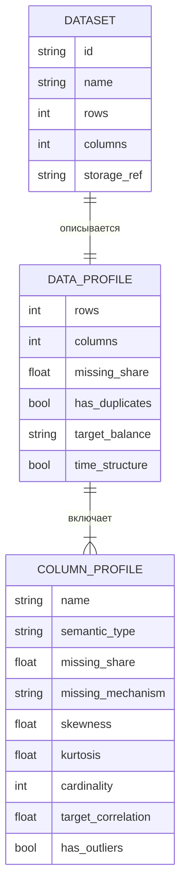

# Архитектура и API

## Общее описание

Клиент-серверная архитектура с разделением на представление, прикладную логику и обработку данных.

| Подсистема | Назначение |
|---|---|
| **Загрузка и хранение данных** | Приём файлов, считывание, хранение текущего состояния набора в памяти серверного процесса |
| **Профилирование** | Профиль набора и столбцов, классификация механизма пропусков, оценка распределений и выбросов |
| **Аналитика и визуализация** | Описательные статистики и корреляции; данные для графиков (распределения, размах, тепловые карты, точечные); сравнение «до/после» |
| **Предобработка** | Обнаружение и предпросмотр обработки пропусков и выбросов; масштабирование и кодирование в режиме предпросмотра; разбиение train/test |
| **Интерфейс (клиент)** | Взаимодействие пользователя с модулем, интерактивные таблицы и графики, управление шагами |

Профилирование и предобработка реализуют адаптивность, аналитика и клиентский интерфейс обеспечивают human-in-the-loop. Подсистемы работают в цикле «профилирование → визуализация → диагностика → предпросмотр трансформаций → разделение данных».

## Схема сущностей

| Сущность | Назначение |
|---|---|
| **Dataset** | Загруженный или промежуточный набор: идентификатор, имя, размерность, ссылка на хранилище, текущее состояние в памяти |
| **DataProfile** | Профиль набора: размерность, общая доля пропусков, дубликаты, баланс цели, временная структура, ссылка на профили столбцов |
| **ColumnProfile** | Профиль столбца: имя, семантический тип, доля и механизм пропусков, статистики, асимметрия/эксцесс, кардинальность, корреляция с целью, признак выбросов |

Визуализации отдельной сущностью не являются: они вычисляются на лету по профилю и текущему состоянию данных.

## Технологический стек

| Уровень | Технологии | Назначение |
|---|---|---|
| Клиент | React + Vite + TypeScript; Ant Design; Ant Design Charts (`@ant-design/plots`) | Интерфейс, таблицы, графики распределений и корреляций |
| Сервер | Python; FastAPI; REST (JSON) | Прикладная логика, маршрутизация, оркестрация подсистем |
| Обработка данных | pandas, NumPy, SciPy, statsmodels | Считывание, профилирование, статистики, проверки распределений и стационарности |
| Предобработка | scikit-learn | Импутация, кодирование, масштабирование, KNN, DBSCAN, разбиение |
| Хранение | Данные в памяти процесса; временное файловое хранилище | Текущий набор, профиль и логи без СУБД |

**Обоснование выбора.** Python даёт зрелую экосистему анализа данных и ML, на которую напрямую опираются методы из [теоретических основ](theory.md). React + Vite + TypeScript обеспечивают быструю сборку и отзывчивый клиент. Ant Design даёт единообразные готовые компоненты, а Ant Design Charts (надстройка над G2/G2Plot) предоставляет декларативные графики распределений, диаграммы размаха и тепловые карты. Разделение клиента и сервера обеспечивает масштабируемость.

## API-функции

Базовая версия работает с одним активным набором данных, поэтому эндпоинты не привязаны к идентификатору сессии.

| Метод | Эндпоинт | Назначение |
|---|---|---|
| POST | `/datasets/upload` | Загрузить набор и инициировать профилирование |
| GET | `/datasets/preview` | Предпросмотр данных и предварительные типы столбцов |
| GET | `/profile` | Профиль набора и описательные статистики по столбцам |
| GET | `/columns/{col}/distribution` | Данные для распределения столбца (гистограмма/плотность, размах) |
| GET | `/correlations` | Корреляционная матрица и значимость признаков относительно цели |
| GET | `/missing` | Карта пропусков и оценка механизма (MCAR/MAR/MNAR) |
| POST | `/preprocess/preview` | Предпросмотр трансформации и данные сравнения «до/после» |
| POST | `/outliers/detect` | Обнаружение выбросов (IQR / z-оценка / DBSCAN) |
| POST | `/split` | Разделение на обучающую и тестовую выборки (опционально со стратификацией) |

Набор покрывает сценарии ПС-1…ПС-8 и СС-1…СС-3 из раздела [Требования](requirements.md).

## Границы и развитие

Следующие возможности проработаны концептуально (см. [теорию](theory.md)), но не входят в базовую версию:

| Направление | Содержание |
|---|---|
| Рекомендации | Генерация ранжированных стратегий очистки с пояснениями |
| Модельная осознанность | Оценка влияния шагов предобработки через прокси-модель |
| История шагов | Журнал применённых преобразований с откатом к любому состоянию |
| Интеграция | Экспорт выборок и конвейера преобразований в основной ML-конструктор, приём контекста задачи (тип задачи, целевая переменная) |
| Безопасность и масштаб | Аутентификация, разграничение доступа, многопользовательский режим, постоянное хранилище |
| Данные | Работа с временными рядами (профилирование по ADF, декомпозиция, специализированная импутация), потоковая обработка |

## Итоги работы

**Часть 1 (анализ)** показала, что ведущие AutoML-платформы автоматизируют моделирование, но предобработку оставляют жёсткой, неадаптивной и слабо связанной с качеством модели.

**Часть 2 (проектирование)** определила теоретический каркас, требования (8 пользовательских и 3 системных сценария), пять подсистем, три сущности, технологический стек и девять API-функций.

Модуль закрывает ключевые пробелы: отсутствие адаптивности, прозрачности и связи предобработки с качеством модели.
