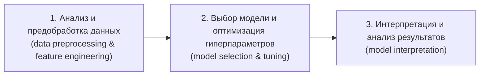

# Состояние проблемы

## Место предобработки в AutoML-пайплайне

Современные AutoML-системы реализуют типичный трёхэтапный пайплайн:

Большинство исследований и инструментов сосредоточено на втором этапе, но именно **первый определяет потенциальный предел качества модели**. По He et al. (2019), подготовка данных и конструирование признаков задают верхнюю границу, а выбор алгоритма и настройка гиперпараметров лишь приближаются к ней. Truong et al. (2019) отмечают, что именно здесь наибольший разрыв между коммерческими и open-source решениями и наибольшая потребность в интерактивности для нетехнических пользователей.

## Дисбаланс в научных работах

Систематический обзор Barbudo et al. (2023) показывает перекос в сторону моделирования:

| Показатель | Значение |
|---|---|
| Работы, сфокусированные на фазе data mining | **93 %** |
| Работы, рассматривающие предобработку данных | **14 %** (в основном очистка и проекция признаков) |
| Автоматизация постобработки и действий, требующих человеческой интуиции | **менее 1 %** |

Генерация визуализаций, интерпретация распределений и интерактивное управление трансформациями практически не рассматриваются.

## Шаблонные стратегии

Bilal et al. (2022) отмечают, что даже ведущие системы применяют фиксированные правила: импутацию средним, удаление выбросов по межквартильному размаху, one-hot-кодирование. Они применяются независимо от структуры данных и игнорируют принцип **«нет универсального решения»**: оптимальная стратегия зависит от типа пропусков (MCAR, MAR, MNAR), формы распределения, временной зависимости и уровня шума.

## Адаптивный подход: Auto-Prep

Auto-Prep (Bilal et al., 2022) вместо жёстких правил тестирует несколько кандидатных методов (например, разные стратегии заполнения пропусков) и ранжирует их по метрикам простых прокси-моделей (наивный байесовский классификатор, дерево решений). Пользователю рекомендуется не «стандартное», а наиболее продуктивное для его данных решение.

## Роль EDA и human-in-the-loop

Dhummad (2025) рассматривает разведочный анализ данных (EDA) как систематический процесс выявления паттернов, аномалий, взаимосвязей и трендов. В отличие от подтверждающего анализа (CDA), EDA не проверяет гипотезы, а позволяет им возникать из данных. В кейсе с банковскими данными переменные, значимые на этапе EDA, остались доминирующими и в финальной модели.

!!! quote "Позиция Dhummad (2025)"
    Автоматизация EDA необходима из-за роста объёмов данных, но она должна не заменять человека, а ускорять итеративный цикл исследования, оставляя аналитику интерпретацию.

Эта позиция согласуется с концепцией **human-in-the-loop AutoML**: система автоматизирует рутину и предоставляет средства исследования и коррекции данных, а человек остаётся активным участником процесса.

## Итог

Состояние проблемы характеризуют четыре признака:

- автоматизация моделирования доминирует над автоматизацией предобработки;
- применяются шаблонные неадаптивные стратегии очистки и трансформации;
- интерактивная визуализация и итеративное исследование поддержаны слабо;
- растёт спрос на прозрачные, контролируемые и ориентированные на пользователя решения.

## Пробелы и вызовы

Анализ платформ и научных работ выявляет пять системных ограничений, которые мешают полноценной автоматизации этапа аналитики и предобработки.

## Пять пробелов

!!! failure "1. Жёсткие неадаптивные стратегии"
    Импутация средним или удаление выбросов по IQR выполняется без учёта типа пропусков, формы распределения, временной структуры и контекста. Это приводит к потере информации и снижению качества модели (Fan et al., 2021).

!!! failure "2. Нет полноценного цикла EDA"
    Отсутствует последовательное прохождение univariate → bivariate → multivariate анализа с интерактивным сравнением распределений до и после каждой трансформации. Визуализации сводятся к статическим отчётам, а не служат инструментом генерации и проверки гипотез (Dhummad, 2025; Tukey, 1977).

!!! failure "3. Разрыв между предобработкой и моделированием"
    Преобразования редко оцениваются по влиянию на качество модели. Исключение — Auto-Prep, где шаги проверяются прокси-моделями, но этот подход не внедрён ни в одну коммерческую платформу.

!!! failure "4. Временные ряды не интегрированы"
    Специализированные решения (Preptimize) с адаптивным профилированием и очисткой не встроены в универсальные AutoML-системы. Методы вроде GAIN, DataWig или DBSCAN для аномалий недоступны в общих задачах.

!!! failure "5. Нет промежуточной модели human-in-the-loop"
    Пользователь либо полностью делегирует контроль (H2O, DataRobot), либо вручную конструирует каждый шаг (Azure ML, Polymatica ML). Не хватает режима, в котором система предлагает обоснованные рекомендации, показывает последствия выбора, а решение принимает человек.

## Сопоставление: пробел → требование к модулю

| Пробел | Что должен делать модуль |
|---|---|
| Жёсткие стратегии | Автоматически профилировать данные и определять структурные свойства |
| Нет адаптивности | Предлагать несколько альтернативных стратегий очистки и трансформации |
| Разрыв с моделированием | Оценивать каждую стратегию по влиянию на качество модели |
| Нет полного EDA | Давать наглядную визуализацию на каждом этапе EDA |
| Нет human-in-the-loop | Поддерживать итеративную корректировку пользователем без программирования |

## Научная новизна и значимость

Совмещение трёх свойств в одном модуле:

- **адаптивная автоматизация**: стратегия выбирается по профилю данных;
- **интерактивная визуализация**: пользователь видит эффект каждого шага;
- **модельная обратная связь**: шаги оцениваются по качеству модели.

Это позволит повысить качество итоговых моделей и доверие нетехнических пользователей к AutoML.

!!! info "Дальше"
    Эти требования переводятся в теоретический каркас на странице [Теоретические основы](theory.md).
