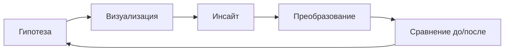

# Визуализация и EDA

Модуль реализует EDA как цепочку связанных визуальных представлений, а не набор статических отчётов. Визуализация рассматривается как инструмент генерации и проверки гипотез в реальном времени (Tukey, 1977; Dhummad, 2025).

## Уровни анализа

| Уровень | Задача | Визуализации |
|---|---|---|
| **Одномерный** (univariate) | Форма, разброс и выбросы отдельного признака | Гистограмма и оценка плотности (непрерывные); столбчатая диаграмма частот (категориальные); диаграмма размаха |
| **Двумерный** (bivariate) | Связь пары признаков и признака с целевой переменной | Точечная диаграмма; корреляционная матрица (тепловая карта); распределение признака в разрезе целевой переменной |
| **Многомерный** (multivariate) | Структура связей между многими признаками | Матрица рассеяния; тепловая карта корреляций нескольких признаков |

Дополнительно для диагностики качества данных используется карта пропусков (тепловая карта).

## Сравнение «до и после»

Ключевое требование, вытекающее из обзора: **интерактивное сравнение распределений до и после каждой трансформации**. Его отсутствие названо одним из главных ограничений существующих платформ.

При любом преобразовании (импутация, обработка выбросов, масштабирование, кодирование) пользователь видит:

- наложенные распределения исходных и преобразованных данных;
- изменение ключевых статистик (среднее, медиана, стандартное отклонение, квартили);
- возможность принять или отменить преобразование.

## Отзывчивость при больших данных

Для больших объёмов применяются агрегация и сэмплирование без существенной потери репрезентативности (Keim et al., 2016), чтобы интерфейс оставался интерактивным.

## Роль визуализации в human-in-the-loop

Цикл «гипотеза → визуализация → преобразование → сравнение» позволяет нетехническому пользователю осознанно корректировать шаги предобработки без программирования.
